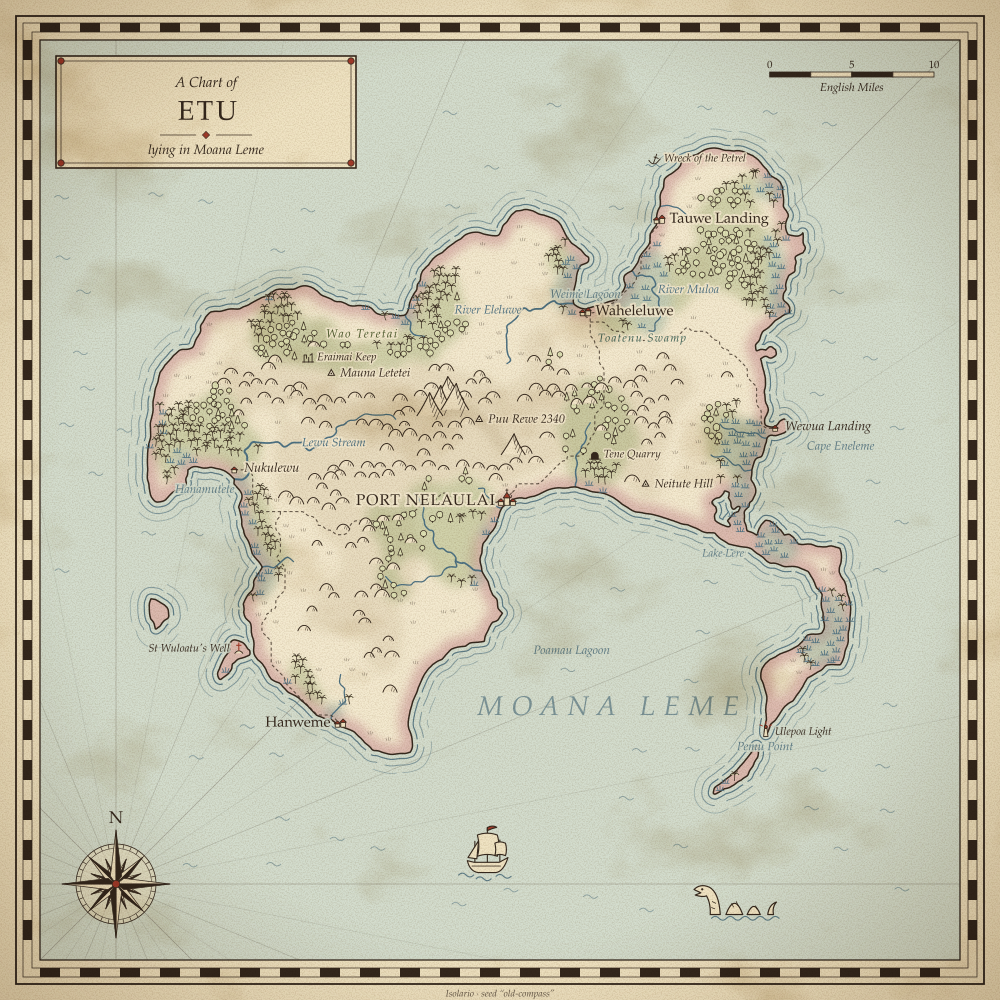

# Isolario

*A book of islands that do not exist.*

An **isolario** was a Renaissance "book of islands": page after page of charts,
each with a few paragraphs on harbours, hazards and local custom. This one writes
itself. Give it any text as a seed and it surveys an island: coastline, rivers,
mountains, towns, roads and place names in the island's own invented language.
It then draws the chart as a hand-inked SVG and writes the pilot-book entry to
go with it.

The same seed always produces the same island, down to the last tree.



## Try it

Open `dist/isolario.html` in a browser. It is a single self-contained file with
no network access: type a seed, or press <kbd>n</kbd> for another island. The
seed lives in the URL, so a link is an island.

Or use the command line (Node 20 or later, no dependencies to install):

```sh
node bin/isolario.js                         # a random island's gazetteer entry
node bin/isolario.js "salt heron"            # the island for that seed
node bin/isolario.js "salt heron" -o chart.svg
node bin/isolario.js "salt heron" -o island.html   # chart and entry on one page
node bin/isolario.js "salt heron" -f json    # the surveyed facts
node bin/isolario.js fleet -n 12 -o atlas.svg      # atlas-fleet-1.svg, ...
```

As a library:

```js
import { generateIsland, renderSVG, gazetteerText } from './src/index.js';

const island = generateIsland('salt heron');
const svg = renderSVG(island);       // the chart
const text = gazetteerText(island);  // the entry
```

## What the text is allowed to say

The gazetteer never contradicts the chart, because its facts are read from the
same model the chart is drawn from. When the entry for seed `f` says Invermolael
"stands on the south coast, at the mouth of the Molael Water", the town is on
the south coast and that river does reach the sea beside it. Areas, coast lengths, heights,
bearings, river lengths and populations are all measured.

Only the colour is invented: what the islanders export, how deep the anchorage
is, why nobody passes the standing stones after dark.

## How an island is made

Each stage draws from its own fork of the seed, so changing one stage never
disturbs another.

| Stage | File | What happens |
| --- | --- | --- |
| Terrain | `src/terrain.js` | One of five shapes (round, long, crescent, twin, shattered) built from soft blobs and fractal noise. The sea level is set at the quantile that leaves the chosen share of the sheet dry. |
| Coast | `src/contour.js` | Marching squares, with saddle handling, turns the height field into closed coastlines. |
| Water | `src/hydrology.js` | A priority flood fills pits, every cell drains to its steepest lower neighbour, and cells that gather enough flow become rivers. |
| Features | `src/features.js` | Woods, marsh, hills and mountains; summits, headlands and bays measured from the terrain. |
| Names | `src/names.js` | Six language flavours, each thinned to a random subset of its sounds, so every island has its own accent. A town at a river mouth can take the river's name. |
| Settlement | `src/settlements.js` | Towns sited by shelter and fresh water, joined by roads routed with A\* that prefer ground already trodden. |
| Chart | `src/render.js` | Masked shore ripples, colour washes, hatched mountains, collision-aware lettering, compass rose, scale bar and cartouche. |
| Entry | `src/gazetteer.js` | The pilot-book prose. |

`src/island.js` ties the stages together, and `src/page.js` lays chart and entry
out as HTML.

## Development

```sh
npm test         # node --test, no dependencies
npm run build    # rebuilds dist/isolario.html and examples/old-compass.svg
```

The build outputs are committed so the explorer works straight from a checkout.
A test fails if they fall out of step with the source, so run `npm run build`
after changing anything under `src/` or `web/`.

`scripts/build.js` contains a deliberately tiny bundler. It understands only
the module syntax this project uses (named imports and exports of relative
files) and stops with an error on anything else.
